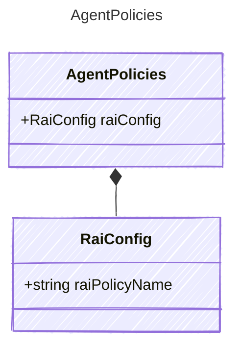

Safety and governance policies for an agent.

## Class Diagram



## Yaml Example

```yaml
raiConfig:
  raiPolicyName: /subscriptions/00000000-0000-0000-0000-000000000000/resourceGroups/my-rg/providers/Microsoft.CognitiveServices/accounts/my-account/raiPolicies/Microsoft.DefaultV2
```

## Properties

| Name | Type | Description |
| ---- | ---- | ----------- |
| raiConfig | [RaiConfig](../raiconfig/) | Responsible AI (content safety) configuration for the agent. |

## Composed Types

The following types are composed within `AgentPolicies`:

- [RaiConfig](../raiconfig/)
