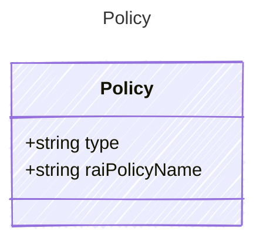

A single safety or governance policy attached to an agent.
The `type` field discriminates the policy kind; the remaining fields are
interpreted based on `type`. For `rai_policy`, `raiPolicyName` associates the
agent with a Responsible AI policy that governs content filtering and safety
guardrails for prompts and completions.

## Class Diagram



## Yaml Example

```yaml
raiPolicyName: /subscriptions/00000000-0000-0000-0000-000000000000/resourceGroups/my-rg/providers/Microsoft.CognitiveServices/accounts/my-account/raiPolicies/Microsoft.DefaultV2
```

## Properties

| Name | Type | Description |
| ---- | ---- | ----------- |
| type | string | The policy type. &#39;rai_policy&#39; attaches a Responsible AI (content safety) guardrail. |
| raiPolicyName | string | For &#39;rai_policy&#39;, the full ARM resource ID of the Responsible AI policy on the Cognitive Services account (e.g., &#39;/subscriptions/&lt;sub&gt;/resourceGroups/&lt;rg&gt;/providers/Microsoft.CognitiveServices/accounts/&lt;account&gt;/raiPolicies/&lt;policyName&gt;&#39;). |
